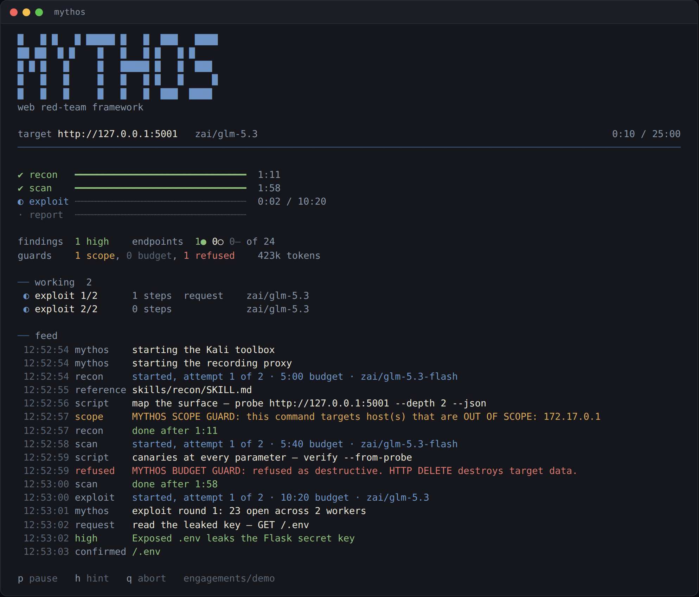

<p align="center">
  
</p>

<p align="center">
  <b>Mythos</b> — an autonomous web red-team agent for authorized pentesting and bug bounty.
</p>

<p align="center">
  <i>Point it at a target you are allowed to test. It maps the surface, reasons about
  the stack, drives real security tools in a Kali container, proves what it finds, and
  writes the report. Four phases, enforced in code, with your own model behind it.</i>
</p>

<p align="center">
  <a href="#install">Install</a> ·
  <a href="#quick-start">Quick start</a> ·
  <a href="#how-it-works">How it works</a> ·
  <a href="#models-and-providers">Models</a> ·
  <a href="#scope-and-safety">Scope and safety</a> ·
  <a href="#what-this-does-not-claim">What it does not claim</a>
</p>

<p align="center">
  <a href="https://github.com/raphaelbleier/mythos-sec/actions/workflows/check.yml"></a>
  <a href="https://github.com/raphaelbleier/mythos-sec/actions/workflows/toolbox.yml"></a>
  <a href="LICENSE"></a>
</p>

---

> **For authorized testing only.** Bug-bounty programs whose scope covers the host,
> systems you own, or lab targets. "Allowed" means written authorization or a
> published program scope, not your own judgement that nobody will mind.
>
> `engagements/<dir>/scope.yaml` is the authorization boundary. Nothing in a run
> widens it. The scope guard warns rather than blocks by default, which means the
> request is already out when you read the warning. Set
> `MYTHOS_SCOPE_ENFORCE=ask` (or `block`) for anything that is not a lab, and the
> call is refused instead.

## What it is

A command-line agent that runs a web application assessment end to end:

```bash
mythos -t https://target.example.com --scope engagements/acme/scope.yaml
```

<p align="center">
  
</p>

It brings its own agent loop, its own tools and its own phase driver. You bring a
model: an API key for any of sixteen providers, or one OpenRouter login that
reaches most of them.

Three things make it different from pointing a coding agent at a target.

**The phases are in code, not in a prompt.** Recon, scan, exploit and report run
as separate agents with fresh context, and each one closes on a file it has to
produce, not on its own opinion that it is finished. A phase that does not produce
its artifact runs again.

**Exploitation closes on coverage, not on satisfaction.** Every endpoint the
surface map found needs an explicit verdict: confirmed with evidence, tested
against the classes its shape suggests, or skipped with a reason. Endpoints
without one are work still owed, and the driver keeps assigning workers until
none are left. This exists because of a measurement: on a target with 76
documented vulnerabilities, agents stopped after a quarter of their budget having
found a third, with whole surfaces never receiving a single request.

**The guards cannot be absent.** Scope checking, rate limiting and the
destructive denylist run inside the tool layer, so every path to the network goes
through them. They used to be host plugin hooks, and a configuration that loaded
no plugin silently measured the framework with all of them inert.

## Install

Needs Node 20 or newer, Python 3.11 or newer, and Docker.

```bash
git clone https://github.com/raphaelbleier/mythos-sec
cd mythos-sec/cli
npm install && npm run build
npm link                      # puts `mythos` on your PATH
mythos doctor                 # checks the machine before a run
```

`mythos doctor` pulls and starts the signed Kali toolbox image on first run, which
takes a few minutes. It also reports whether your model profile has an independent
validator, because that changes what a finding can claim.

For the browser tool:

```bash
npx playwright install chromium
```

## Quick start

Against a lab target, with a scope file generated for that host and port alone:

```bash
mythos -t http://127.0.0.1:5001
```

Against a real program, with your own scope file:

```bash
mythos -t https://target.example.com \
  --scope engagements/acme/scope.yaml \
  --budget 7200 --workers 4
```

Quietly, for a cron job or CI:

```bash
mythos -t https://target.example.com -s engagements/acme/scope.yaml -n
```

While a run is up you can press `p` to pause, `h` to send the agents a hint
("the admin panel is on 8443"), and `q` to abort. Nothing ever waits for you.

Results land in the engagement directory:

```
engagements/<host>-<date>/
  scope.yaml          the authorization boundary
  surface.json        the surface map
  cve-candidates.json ranked CVE candidates for the fingerprinted stack
  recon.md            stack, identities, promising surfaces
  candidates.md       what is worth an exploitation attempt
  findings/<id>.md    one file per finding, with its evidence pair
  verdicts/           one verdict per endpoint
  verdicts.json       the ledger
  validation.md       the independent review pass
  report.md           the deliverable
  findings.json       machine-readable, with CVSS computed from each vector
  findings.sarif      SARIF 2.1.0, for a CI annotation
  traffic/            every request and response, replayable, HAR-exportable
  run-events.jsonl    the whole run as an event stream
```

## How it works

```
scope.yaml ──► recon ──► scan ──► exploit ──► report
                 │         │        │ │ │        │
                 │         │        └─┴─┴─ parallel workers, one verdict
                 │         │                per endpoint
                 ▼         ▼                       ▼
            surface.json  candidates.md      report.md + findings.json
            cve-candidates.json              + an independent validator pass
```

Each phase reads `skills/<phase>/SKILL.md` for its methodology and the
`knowledge/` playbook for a class before trying it. Those files are the
methodology and they are meant to be read and edited; the CLI is only what runs
them.

The agent has six tools and nothing else:

| Tool | What it reaches |
|---|---|
| `shell` | a shell pipeline in the Kali container: nuclei, sqlmap, ffuf, httpx, katana, dalfox, nikto, arjun, jwt_tool, curl, jq |
| `request` | one HTTP request, recorded and replayable |
| `script` | the deterministic tools below |
| `browser` | a real Chromium: navigate, click, type, read the DOM, run JavaScript, read the console and the network log |
| `files` | the engagement directory |
| `reference` | the repository's own skills and knowledge base |

The small set is deliberate. The published evidence is that the tool layer
decides the outcome: in one study every model scored zero without high-level
actions, and small models with them beat large models without. So the work went
into making a few tools carry a lot.

### The deterministic tools

Each of these collapses what would otherwise be dozens of model round trips, and
each has a `--selftest`.

| Script | What it is for |
|---|---|
| `probe` | map the surface, GET only except the GraphQL introspection POST |
| `verify` | send benign canaries at named parameters and judge each against an oracle |
| `cvefeed` | KEV, EPSS, NVD, nuclei templates, GHSA and OSV, ranked for this stack |
| `coverage` | which mapped paths the report does not account for |
| `findings` | `findings.json` and SARIF, CVSS from the vector, dedup, `--diff` for retest |
| `sourcemap` | routes, missing guards and sinks from a source tree (grey box only) |
| `traffic` | what was sent, byte-exact replay, HAR export |
| `watch` | what changed on a tested target since last time |
| `lessons` | class priors from past engagements (read its own caveat first) |

`cvefeed` matters more than it looks. An agent given the CVE description reached
87% on a one-day benchmark against 7% without it, so knowing what to look for is
most of the result.

## Models and providers

```bash
mythos login openrouter            # OAuth, mints a real key
mythos login anthropic --api-key sk-ant-...
mythos providers                   # what is reachable, and how
mythos -t <url> --model openrouter/z-ai/glm-5.3
mythos -t <url> --profile anthropic
```

`models.json` assigns a tier to each agent and maps tiers to models per profile.
The validator tier must differ from the hunting tier: a model approves its own
errors 11.9 percentage points more often when it wrote them, and that bias follows
authorship rather than the context window, so re-asking the same model in a fresh
conversation is not an independent check. A profile that cannot offer a second
model says so, and every report from it carries the limitation.

Sixteen providers are reachable by API key, including OpenAI, Anthropic, Gemini,
Z.ai, Moonshot, DeepSeek, xAI, Groq, Mistral, Cerebras, Together and Nebius, plus
Ollama and LM Studio locally and any OpenAI-compatible endpoint.

**On subscription logins.** OpenRouter's OAuth flow is implemented, because
OpenRouter publishes it for third-party clients and it hands back a real API key.
Consumer plan logins for ChatGPT, Claude and Copilot are not, and will not be:
those flows work by presenting another client's OAuth credentials, the providers
either forbid them outright or merely tolerate them, and the account that gets
suspended belongs to the user, not to this repository. One OpenRouter login
reaches most of the models above.

## Scope and safety

`engagements/<dir>/scope.yaml` names the hosts, the ports and the rate limit. The
run never widens it.

| Rule | Mode | Why |
|---|---|---|
| out-of-scope host | warns, or refuses with `MYTHOS_SCOPE_ENFORCE=ask`/`block` | scope is a judgement about authorization, and it is yours |
| rate limit | warns, and paces single calls | a program's limit is a courtesy you may have negotiated |
| data destruction, brute force, denial of service | refused, in every mode | the one hard line |

The hard line is not a setting because a prompt rule did not hold. During
benchmarking a run sent `{deleteAllPastes}` in a GraphQL body, received
`{"data":{"deleteAllPastes":true}}` and emptied the target's table. The guard at
the time read the shell and never saw a destructive operation named inside a
request body. It does now.

Scoped destruction is allowed and warned about, because deleting the object you
created yourself is how an access-control finding gets proven without touching
another user's data.

There is no request ceiling and no exploitation gate. This is a bug-bounty suite:
proving a finding is the work, not an exception to it.

## Responsible use

A request the target makes on your behalf counts as yours. During benchmarking a
run placed `169.254.169.254` in an SSRF payload and the target made the
connection to the cloud metadata service. The destination of an SSRF probe has to
be in scope too.

Testing an application you are not authorized to test is a crime in most
jurisdictions, whatever tool sent the request. The scope file exists so that
decision is explicit, written down and dated.

To report a vulnerability in Mythos itself, see [`SECURITY.md`](SECURITY.md).

## What this does not claim

The project measured itself against a bare agent with the same model on three
deliberately vulnerable applications, 106 paired vulnerabilities, two blinded
raters. It found **no detectable difference in recall** (p = 1.0000 and
p = 0.1435), with the minimum detectable difference at that sample size being 15
percentage points. It did find that the two arms covered *different*
vulnerabilities at equal totals, which is a smaller and more honest claim.

That benchmark harness is no longer in the repository, and none of the numbers
above describe the current code: the agent was rebuilt from a host plugin into
this CLI, and the phase driver and verdict ledger are new. Treat the published
figures as what motivated the rebuild, not as its result. They are in the git
history.

What the current code has been shown to do is narrower and unblinded: one run
against the local lab target, 50 minutes on GLM 5.3, all four phases closing on
their artifacts, 21 findings with evidence, a verdict for all 36 mapped
endpoints (28 confirmed, 8 tested), and 534 recorded request and response pairs.
That is a working pipeline, not a measurement: one target, one run, no control
arm and no blinded rater.

Other limits worth knowing before you trust it:

- The coverage gate is a text check over the report. It cannot tell a real test
  from a mention, so it is a floor on coverage, never evidence of it.
- `scripts/lessons` reports precision among reported findings, not yield, because
  nothing records "I tested this class and found nothing". It is a tie-breaker.
- All three benchmark targets are public repositories with public write-ups, and
  nothing measures how much of them is in a model's training data.
- `scripts/sourcemap` produces a hypothesis list, not findings.

## Layout

```
cli/               the agent: phase driver, tool layer, providers, full-screen view
  src/driver.ts      phase order, artifact gates, exploit fan-out
  src/agent/         the loop, the six tools, the guard call site
  src/providers/     sixteen providers, OpenRouter OAuth, credential store
skills/            the methodology, one directory per phase and per class
knowledge/         per-class confirmation playbooks and CVE technique notes
hooks/             scope-guard and budget-guard, called by the tool layer
scripts/           the deterministic tools, each with a --selftest
toolbox/           the two-stage Kali toolbox Dockerfile
lab/               vulnerable targets, an OAST catcher and an admin bot
docs/              architecture, model policy, continuous mode, research notes
AGENTS.md          the rules every agent in a run is given
```

## License

MIT, see [`LICENSE`](LICENSE). Built for security engineering research into AI
pentest agents.

Pull requests are welcome; read [`CONTRIBUTING.md`](CONTRIBUTING.md) first.
