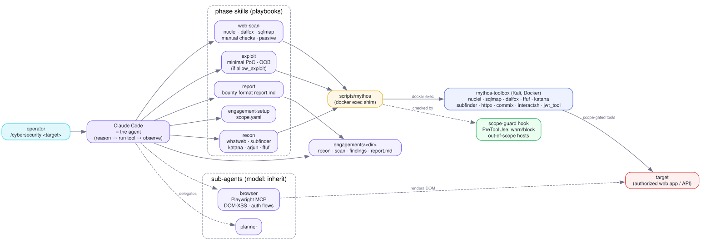

<p align="center">
  <picture>
    <source media="(prefers-color-scheme: dark)" srcset="docs/assets/logo-dark.svg">
    
  </picture>
</p>

<p align="center">
  <b>Mythos</b> — a skill-driven web red-team framework for OpenCode and Claude Code, for authorized pentesting and bug bounty.
</p>

<p align="center">
  <i>Point <code>/cybersecurity</code> at a target you're allowed to test. Your agent host <b>is</b> the agent: it reasons like a pentester and drives real security tools in a Kali toolbox to find — and prove — web vulnerabilities. No API key of its own.</i>
</p>

<p align="center">
  <a href="#install">Install</a> ·
  <a href="#quick-start">Quick start</a> ·
  <a href="#how-it-works">How it works</a> ·
  <a href="#benchmarks">Benchmarks</a> ·
  <a href="#scope--safety">Scope &amp; safety</a> ·
  <a href="#responsible-use">Responsible use</a>
</p>

<p align="center">
  <a href="https://github.com/raphaelbleier/mythos-sec/actions/workflows/check.yml"></a>
  <a href="https://github.com/raphaelbleier/mythos-sec/actions/workflows/toolbox.yml"></a>
  <a href="LICENSE"></a>
</p>

---

> **For authorized testing only.** Bug-bounty programs in scope, systems you own,
> or lab targets. "Permitted" means written authorization or a program whose scope
> covers the host, not your own judgement that nobody will mind.
>
> `scope.yaml` is the authorization boundary and a hook watches it, but in the
> default `warn` mode the request is already out when the warning arrives. Set
> `MYTHOS_SCOPE_ENFORCE=ask` for anything that is not a lab. With `--scope <file>`
> the engagement then runs unattended, with shell access, until it writes a report.

## Results at a glance

On single-flag CTF challenges the scaffolding adds nothing this evaluation can
measure. Across every XBOW sweep the Mythos arm ties with a bare model that has a
shell: 28/33 against 27/30 on a 40-challenge sweep, paired p = 1.0, with 7 and 10
of the 40 cells unscored because a safety classifier ended them mid-run. That is a
null result.

On one broad target it does separate, once a coverage gate forces the agent to
account for every mapped path before it stops. Against Vuln Bank's 76 documented
vulnerabilities, Mythos with the gate finds 34 and 33 where the control finds 30
and 29, at roughly twice the tool calls and twice the money. The same gate inverted
the result on DVGA, 6 of 21 against 12 without it, because that app's surface map
missed the GraphQL fields where every documented vulnerability sits. The gate helps
where the map is right and hurts where it is not, and it was written after the runs
it is scored against.

Precision was 1.00 in all six Vuln Bank runs under hand triage. Nothing in the code
enforces that; "proven" and "unconfirmed" are conventions the agent is told to follow.

The scope guard is a safety net, not a sandbox. In its default `warn` mode it reports
an out-of-scope request after the request has already gone out, and it has let one
through: a `169.254.169.254` SSRF payload that the target then connected to. Set
`MYTHOS_SCOPE_ENFORCE=ask` when a single such request is unacceptable.

Full tables, parameters and what the numbers do not cover: [Benchmarks](#benchmarks),
[`docs/poster/poster.md`](docs/poster/poster.md) (German),
[`docs/poster/LIMITATIONS.md`](docs/poster/LIMITATIONS.md).

## What it is

Mythos is in the spirit of CAI / Strix / HexStrike / PentestGPT, but
**skill-driven, with no separate engine and no LLM runtime of its own.** The
agent host (OpenCode first, Claude Code second) is the agent loop. Mythos
supplies the methodology (skills), the orchestration (one orchestrator, six
sub-agents), a Kali tool belt (Docker), a per-bug-class knowledge base, and a
scope guard.

- **`/cybersecurity` command**: the orchestrator. Sets up a scoped engagement,
  then runs recon, scan, exploit, report.
- **Phase skills**: `engagement-setup`, `recon`, `web-scan`, `exploit`,
  `report`, `toolbox`, plus capability skills `auth-session`,
  `business-logic`, `stored-xss-oast`, `deep-server` and the maintenance skills
  `research-ingest` and `cve-deep-dive`. Findings carry a closure state
  (candidate / confirmed / ruled_out / open_proof_gap).
- **Sub-agents**: planner, recon, scanner, browser, exploiter, reporter, using
  the session model.
- **Kali toolbox** (Docker): nuclei, sqlmap, dalfox, ffuf, katana, subfinder,
  httpx, nikto, commix, interactsh, jwt_tool and more, run through
  `scripts/mythos`; headless Chromium for the browser agent.
- **Knowledge base** (`knowledge/`): per-class confirmation playbooks read at
  runtime to cut false positives.
- **One canonical source**: `AGENTS.md`, `.opencode/` and `skills/` are
  hand-edited; `python3 scripts/build-hosts.py` generates the Claude Code files
  (`CLAUDE.md`, `agents/`, `commands/`).

## Architecture



The host is the agent; skills are the playbooks; the shim runs real tools in
the Kali container against the target; the scope guard watches bash/webfetch
calls. (Source: `docs/assets/architecture.dot` — `dot -Tsvg` renders it.)
Full write-up: [`docs/architecture.md`](docs/architecture.md). Status and open work:
[`docs/plan/ROADMAP.md`](docs/plan/ROADMAP.md).

## Install

**Prerequisites**

- [OpenCode](https://opencode.ai) (1.x >= 1.18.29 or 2.x), primary, or
  [Claude Code](https://docs.claude.com/en/docs/claude-code), secondary.
- A model for the host: any provider the host supports. No model ships
  configured. On OpenCode run `/connect`, or set `model` in `opencode.json`; the
  Z.ai provider in that file is an example reading `LLM_API_KEY`, replace it with
  your own. On Claude Code the host's own model is used.
- **Docker**, with your user able to run `docker`. `git`, and Python 3 (stdlib
  only) for the shim.

**1. Get the repo**

```bash
git clone https://github.com/raphaelbleier/mythos-sec
cd mythos-sec
```

**2a. OpenCode (primary)**: nothing to install. Run `opencode` in the repo; it
reads `opencode.json` (default agent `mythos`, `AGENTS.md`, the `skills/` path)
and `.opencode/` (agents, `/cybersecurity` command, scope-guard plugin).
Non-interactive:

```bash
opencode run --agent mythos --auto "https://target.example --scope scope.yaml"
```

**2b. Claude Code (secondary)**: install the plugin straight from GitHub (Claude
Code 2.1.275 or later)

```text
/plugin install mythos-sec --marketplace raphaelbleier/mythos-sec
```

From a clone, or on an older build:

```text
/plugin marketplace add /path/to/mythos-sec
/plugin install mythos-sec
```

**3. Toolbox**: `scripts/mythos up` pulls the prebuilt image from GHCR and starts
it (no local build):

```bash
docker pull ghcr.io/raphaelbleier/mythos-toolbox:latest   # optional, `up` does this
scripts/mythos up          # pull (or build) the image, start the container
scripts/mythos tools       # sanity-check the tool belt
```

Pin a tag for reproducibility (`MYTHOS_IMAGE=ghcr.io/raphaelbleier/mythos-toolbox:<tag>`;
tags are `vX.Y.Z`, `X.Y`, `YYYYMMDD`, `sha-...`; the workflow publishes amd64 and
arm64). `latest` and `v0.2.0` are published and pullable today. To build locally
instead: `MYTHOS_BUILD=1 scripts/mythos up` (first build takes minutes).

**4. (optional) practice lab**: see [`lab/README.md`](lab/README.md)

```bash
docker compose -f lab/docker-compose.yml up -d
scripts/mythos net mythos-lab     # let the toolbox reach lab targets by service name
```

**5. Verify** end to end:

```bash
scripts/selftest.sh                   # 35 checks: probe, verify, 7 vuln classes, 2 no-FP controls, scope-guard, coverage gate
scripts/selftest.sh --host opencode   # same checks, scored from the mythos agent's report
```

**Platform notes**

- **Linux**: Docker engine; add your user to the `docker` group.
- **macOS**: Docker Desktop. Local lab targets are reached from the toolbox as
  `http://host.docker.internal:<port>`. Untested by the maintainer.
- **Windows**: Docker Desktop with WSL integration; run the repo and the host
  inside WSL, or use Git Bash (the shim sets `MSYS_NO_PATHCONV` so `/repo` is not
  rewritten). Only the WSL path has been exercised; native Windows is untested.

You need a model for the agent host; Mythos itself needs no extra API key.

## Quick start

```text
/cybersecurity https://target.example
```

Mythos sets up `engagements/<target>-<date>/`, writes a `scope.yaml` you confirm
(or takes yours via `--scope`),
then runs recon → scan → exploit → report, driving the toolbox throughout, and
writes a bug-bounty-format `report.md`.

The model is whatever the host is configured to use (`/model` in Claude Code,
`--model` in `opencode run`); every agent uses it.

The single human gate is the scope confirmation. With `--scope <file>` (also
with `opencode run --auto`) the file is the confirmation and nothing is asked;
after that the engagement runs unattended. The rules it follows (non-destructive,
no DoS or brute force, minimal PoC, no data dumping) are instructions to the model,
not limits enforced in code: on DVGA the control arm deleted another user's paste.
See [`docs/poster/LIMITATIONS.md`](docs/poster/LIMITATIONS.md).

A scope file you bring yourself looks like this. Put it anywhere and pass it with
`--scope`; Mythos copies it to `engagements/<target>-<date>/scope.yaml`, which is the
boundary for the whole run:

```yaml
target: https://target.example
in_scope:
  - target.example      # only the hosts or CIDRs the program lists; *.example.com for wildcards
out_of_scope: []        # every excluded host the program names
rules:
  rate_limit_rps: 5
  max_requests: 20000
  allow_active: false   # true only if active scanning is permitted
  allow_exploit: false  # true only if PoC exploitation is permitted
identities: []          # optional: two accounts, for BOLA and IDOR testing
notes: ""               # paste the program's testing rules verbatim
```

Useful sub-commands:

```text
/cybersecurity research CVE-2026-1234     # CVE deep-dive -> knowledge-base note
/cybersecurity research <topic>           # ingest a technique into knowledge/
```

## How it works

Everything runs in the `mythos-toolbox` Kali container via `scripts/mythos`:

```bash
scripts/probe <url> --depth 2          # surface map in one call, on the host, no container
scripts/probe <url> --depth 2 --json | scripts/verify --from-probe   # prove the aim points
scripts/mythos up                      # build (first run) + start the container
scripts/mythos <tool> [args]           # run one tool,  e.g. scripts/mythos nuclei -u URL
scripts/mythos sh '<pipeline>'         # run a shell pipeline in the toolbox
scripts/mythos tools                   # list the belt + versions
scripts/mythos net <network>           # attach the toolbox to a lab docker network
scripts/mythos down                    # stop + remove the container
```

The repo is mounted at `/repo`, so output lands under `engagements/`. A local
lab target on `localhost:PORT` is reached as `http://host.docker.internal:PORT`.
`toolbox/Dockerfile` (two-stage) builds the belt; a tool missing from a given
Kali snapshot is skipped, never fatal. Every exec is logged to
`engagements/audit.jsonl`.

## Classes the skills target

Reflected & DOM XSS, SQLi (error + blind + UNION, via sqlmap), GraphQL-resolver
SQLi, SSTI → RCE, OS command injection (reflected + blind/OOB), SSRF (out-of-
band via interactsh), path traversal / LFI + filter-evasion, open redirect,
CRLF, IDOR + two-account BOLA, CORS, JWT forgery / privilege escalation,
GraphQL introspection + code execution, API excessive-data-exposure,
sensitive-file exposure, verbose-debug disclosure, security headers/cookies;
authenticated flows (cookie/bearer, Playwright for SPAs); OpenAPI/GraphQL
import; CVE triage (KEV/EPSS, patch-diff); nuclei templated scanning.

This is what the skills aim at, not a measured success rate. Only the classes named
under [Benchmarks](#benchmarks) and in the self-test have numbers behind them.

## Benchmarks

**Controlled evaluation.** `bench/` runs Mythos and a bare-model control on the
XBOW validation-benchmarks with the same model, prompt, budget and sandbox, a
random flag per run, scoring on the harness side, Wilson intervals and paired
McNemar tests. Protocol, usage and isolation rules:
[`bench/README.md`](bench/README.md).

On flag-capture challenges the result is a null: across every sweep the Mythos
arm does not separate from the control. On the one broad target with a
documented vulnerability list, Vuln Bank, it does separate, but only after a
coverage gate was added that makes the agent account for every mapped path
before it stops (two repeats per condition, ranges that do not overlap):

| Vuln Bank, 76 documented vulnerabilities (Claude Code, Sonnet, 3600 s budget) | found | recall | precision | tool calls | USD |
|---|---|---|---|---|---|
| Mythos + coverage gate | 34, 33 | 0.45, 0.43 | 1.00 | 32, 31 | 0.61, 0.67 |
| Mythos without the gate | 28, 29 | 0.37, 0.38 | 1.00 | 18, 20 | 0.42, 0.39 |
| control (bare model with a shell) | 30, 29 | 0.39, 0.38 | 1.00 | 15, 14 | 0.29, 0.25 |

The gate costs about twice the control's tool calls and money for the extra
entries (four to five against the control, n = 2 per arm, no significance test). It was written after the ungated Vuln
Bank runs and scored on the same target, so it is a fit to that measurement, not a
prediction confirmed by it.

**The same gate inverted the result on DVGA: 6 of 21 against 12 without it and 11 for
the control, at $0.77 instead of $0.27.** DVGA is a GraphQL app whose surface map held
eleven HTML pages while all 21 documented vulnerabilities sit behind `/graphql`, so the
agent closed out the pages and never reached the fields. Vuln Bank worked because it
publishes an OpenAPI document. The probe now introspects GraphQL schemas, but the
measurement with that map is still outstanding. The gate helps where the map captures
the real surface and hurts where it does not.

The flag-capture sweeps:

| sweep | model | Mythos | control | paired p |
|---|---|---|---|---|
| 40 challenges, scaffolding verified loaded | Claude Sonnet | 28/33 = 0.85 | 27/30 = 0.90 | 1.0 |
| 40 challenges (plugin silently not loaded) | Claude Sonnet | 28/33 = 0.85 | 27/30 = 0.90 | 1.0 |
| 12 challenges | GLM 5.3 | 10/10 = 1.00 | 10/10 = 1.00 | 1.0 |
| earlier shared failures | Claude Sonnet | 2/5 = 0.40 | 2/5 = 0.40 | 1.0 |
| VAmPI, recall against 9 documented vulnerabilities | Claude Sonnet | 8/9 = 0.89 | 8/9 = 0.89 | - |
| DVGA, recall against 21 documented vulnerabilities | Claude Sonnet | 12/21 = 0.57 | 11/21 = 0.52 | - |
| Vuln Bank, recall against 76 documented vulnerabilities (no gate) | Claude Sonnet | 28/76 = 0.37 | 30/76 = 0.39 | - |

Cells a safety classifier ended mid-run are unscored (`classifier_blocked`),
like a provider refusal: that was 7-9 of the 12 unsolved cells per arm on the
Claude Code host.

On challenges with one planted vulnerability and a flag, the scaffolding adds
nothing these samples can detect, and all three flagless recall measurements
agree: the arms tie on VAmPI, sit one entry apart on DVGA (and tie at 10 of 16
once the five denial-of-service classes the safety rules forbid proving are
excluded) and one apart on Vuln Bank until the coverage gate, which lifts the scaffolded
arm clear of the control (table above) by making it reach the GraphQL, merchant
and card surfaces both arms had skipped entirely. On GLM 5.3 both arms solved 10 of 10 and Mythos was faster, median 135 s against
177 s, with n = 10 per arm and no significance test. On Claude Sonnet with the
framework loaded it cost 2.4x the control for a solve rate that was equal or one
cell lower. Cost does not always run that way: on DVGA the scaffolded arm came in
at $0.27 against the control's $0.81, with 18 tool calls against 43. An invalid plugin manifest had kept the Claude Code mythos arm
unscaffolded until 5 November 2026; the rerun is the first row. Full parameters and the diagnosis from the transcripts:
[`docs/poster/poster.md`](docs/poster/poster.md) (German). What the numbers do not cover:
[`docs/poster/LIMITATIONS.md`](docs/poster/LIMITATIONS.md).

```bash
python3 bench/xben.py check --out <build_results.tsv>
python3 bench/run.py --frameworks mythos,control --model <id> --sample 30 --seed 1 --runs 3 --dry-run
python3 bench/stats.py <results>/results.jsonl --compare mythos,control
python3 bench/labs.py list                       # flagless targets + ground truth
```

The four flagless real apps (crAPI, Vuln Bank, DVGA, VAmPI) are scored by recall
against their upstream documented vulnerability lists in
`bench/data/ground_truth/`, driven by `bench/labs.py`; VAmPI's secure instance
serves as a false-positive control. Build lists for the 104 XBOW challenges are
in `bench/data/`: 43 of 104 build from a clean clone, 102 of 104 once the harness
repoints the dead Debian apt mirrors (`--no-apt-fix` disables that).

The self-test is a regression test on this repo's own seeded lab app, not a target
result: 35 of 35 checks pass (`scripts/selftest.sh`).

**Earlier manual engagements** (single runs, no control arm, from the earlier
skill-driven flow; evidence, not a measured advantage). Details:
[`docs/poster/benchmark-skill-driven.md`](docs/poster/benchmark-skill-driven.md),
[`docs/poster/benchmark-hard-targets.md`](docs/poster/benchmark-hard-targets.md).

| Target                  | Stack                        | Headline confirmed findings                                                                                                             |
| ----------------------- | ---------------------------- | --------------------------------------------------------------------------------------------------------------------------------------- |
| **OWASP Juice Shop**    | Node SPA + REST              | UNION SQLi (Users dump), `/ftp` disclosure, poison-null-byte filter bypass, open redirect, config leak, **DOM XSS** (browser-confirmed) |
| **DVGA**                | Python GraphQL               | **unauth RCE** (introspection → SSRF → command injection), broken access control, introspection                                         |
| **VAmPI**               | Python REST                  | `_debug` plaintext-password dump; a BOLA **tested and disproven** (not over-claimed)                                                    |
| **Vuln Bank** (2026)    | Flask + PostgreSQL + GraphQL | `.env` leak → **JWT forge → admin takeover**, GraphQL-resolver SQLi, verbose-debug disclosure                                           |

Honest limits: full crAPI does not fit a ~3.7 GB host. "Works on any web app"
is not provable without authorized access to each target.

## Scope & safety

- Scope is stated up front and watched by a warn-only scope guard
  (`hooks/scope-guard.py` as a Claude Code `PreToolUse` hook,
  `.opencode/plugin/scope-guard.ts` for OpenCode; set
  `MYTHOS_SCOPE_ENFORCE=ask` to decide per call, `=block` to hard-block
  out-of-scope hosts). It is a safety
  net, not a sandbox; coverage inside OpenCode sub-agents is not yet verified.
  The agent honors `scope.yaml` in every tool call.
- Non-destructive by default; exploitation only when `scope.rules.allow_exploit`
  is set; proofs are minimal (no data dumps, no DoS, no brute-force).
- Engagement data lives under `engagements/` and is git-ignored.

## Responsible use

Mythos is offensive security tooling. Use it only against systems you own,
bug-bounty programs within their stated scope, or lab targets, and only with
authorization in writing or in the program's published scope.

Unauthorized access is a criminal offence in most jurisdictions: the Computer
Fraud and Abuse Act in the United States, the Computer Misuse Act in the United
Kingdom, § 118a StGB in Austria, § 202a StGB in Germany, and equivalents
elsewhere. A bug-bounty program's safe-harbour terms protect you only inside the
scope they state.

Practical points a first run should know:

- Requests the toolbox sends come from your own IP and are attributable to you.
  There is no proxying and none is planned.
- `engagements/audit.jsonl` logs every toolbox command, before and after. It is
  your record of what was sent. Keep it.
- A request the target makes on your behalf, such as an SSRF probe, counts as
  yours. The destination has to be in scope too.
- The scope guard and rate limits reduce risk but do not grant permission, and in
  the default `warn` mode the guard cannot stop a request. What has gone wrong in
  practice is written down in
  [`docs/poster/LIMITATIONS.md`](docs/poster/LIMITATIONS.md): one out-of-scope
  SSRF payload that the target connected to, and seed-data changes on DVGA.

The software is provided as is, without warranty (MIT). Mythos is an independent
project and is not affiliated with Anthropic or with the OpenCode project.

## Layout

```
AGENTS.md          canonical project instructions (CLAUDE.md imports it)
opencode.json      OpenCode config (default agent, skills path)
.opencode/         canonical agents, /cybersecurity command, scope-guard plugin
commands/ agents/  generated for Claude Code by scripts/build-hosts.py
skills/            engagement-setup · recon · web-scan · exploit · report · toolbox
                   · auth-session · business-logic · stored-xss-oast · deep-server
                   · research-ingest · cve-deep-dive
hooks/             scope-guard (PreToolUse hook + shared --check logic)
                   coverage-gate (Stop hook: every mapped path must be accounted for)
toolbox/           two-stage Kali toolbox Dockerfile
.github/           toolbox image CI (GHCR, amd64 + arm64)
lab/               vulnerable targets, OAST catcher, admin bot
bench/             XBOW harness, flagless-lab runner, ground truth, build lists
scripts/           mythos (toolbox shim) · probe (surface map) · verify (canary proofs)
                   · selftest.sh · build-hosts.py
knowledge/         per-class confirmation playbooks + CVE technique notes
docs/              architecture, research, plan, poster/benchmark evidence
CONTRIBUTING.md    how to change the canonical files and run the self-test
SECURITY.md        how to report a vulnerability in Mythos itself
```

## License

MIT. See `LICENSE`. Built by raphaelbleier for Security Engineering research
into AI pentest agents.

Pull requests are welcome; read [`CONTRIBUTING.md`](CONTRIBUTING.md) first, since
the files in `agents/` and `commands/` are generated and must not be hand-edited.
To report a vulnerability in Mythos itself, follow
[`SECURITY.md`](SECURITY.md).
