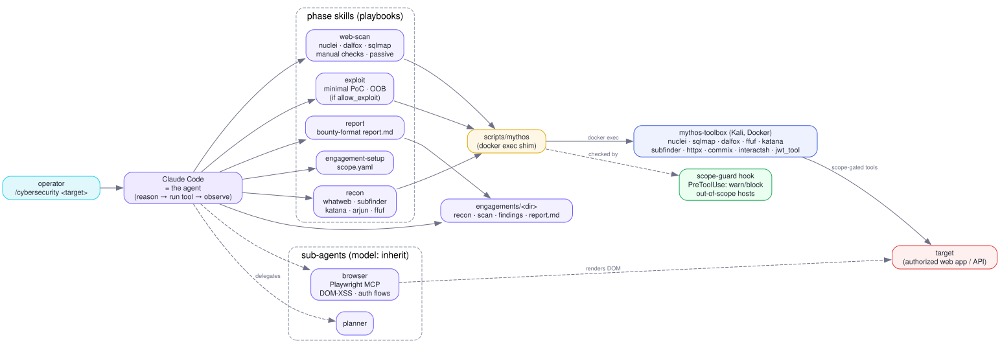

# Mythos architecture

Mythos is a TypeScript CLI with its own agent loop. It used to be a plugin for
two agent hosts, which meant the behaviour of a run depended on which host the
operator started and whether that host loaded the plugin at all. Now the phase
order, the guards and the closure rules live in code that ships with the
methodology. The methodology itself is not code: `skills/*/SKILL.md` are the
phase and class playbooks, `knowledge/` holds the per-class confirmation
playbooks, and `scripts/*` are the deterministic tools. The CLI reads them.



## What runs where

| Process | Code | What it is for |
|---|---|---|
| `mythos` (Node) | `cli/src/` | the driver, the agent loop, the tool layer, the renderer |
| model API | a provider's endpoint | the agents themselves. One HTTPS call per step |
| `mythos-toolbox` (Docker, Kali) | `toolbox/Dockerfile`, driven by `scripts/mythos` | every security tool, and the `shell` and `request` tools' traffic |
| Python child processes | `scripts/*`, `hooks/*.py` | the deterministic tools and the two guards, one `execFile` per call |
| Chromium | `playwright-core`, launched by the CLI | the client-rendered surface. Not in the container |

The model never touches the target: it emits tool calls and the CLI executes
them. Two things reach the target from the host rather than from the container,
and both are vetted by the same guards as everything else.

`probe` and `verify` send their own requests. The `script` tool runs them
through `scripts/traffic exec`, which hands them the proxy variables a host
command needs, so the surface map and the canary pass appear in the recording
like everything else. They used to run without it, which left the two calls a
reader would most want to replay as the only unrecorded traffic in an
engagement.

Chromium is the exception that stays unrecorded: the proxy terminates TLS with a
per-run CA, and teaching a browser to trust it would mean shipping a root
certificate (`cli/src/agent/browser.ts`). Its console and network log are read
back through the `browser` tool instead.

## The driver

`cli/src/driver.ts` holds the phase order: recon, scan, exploit, report. Each
phase is a separate agent with a fresh context. There is no long-lived
orchestrator, because the measured failure of the previous design was an agent
that walked the phases itself and decided it was finished at a quarter of its
budget with two thirds of the target untouched.

A phase closes on an artifact, not on an opinion:

| Phase | Agent | Closes when |
|---|---|---|
| recon | `mythos-recon` | `surface.json` exists and maps at least one item, and `recon.md` exists |
| scan | `mythos-scanner` | `candidates.md` exists |
| exploit | `mythos-exploiter` | every endpoint in the surface has a verdict |
| report | `mythos-reporter` | `report.md` and `findings.json` exist |

Miss the artifact and the phase runs again with whatever it left behind, up to
`--retries` times (default 2, so three attempts), with a prompt that says to
keep the existing files and produce the missing one rather than start over.
After the last attempt the phase is recorded `incomplete` and the run continues:
a half-finished engagement that says so is worth more than one that hangs
overnight. `--skip recon,scan` records a phase `pending` instead.

Two small repairs sit in the gate: the report gate runs `scripts/findings` for
the agent when `report.md` is there and `findings.json` is not, and the exploit
gate re-reads `verdicts/*.md` before it judges, so a verdict written in the last
seconds of a round still counts.

## Handoff

A phase hands off through files in the engagement directory and nothing else.
The next agent starts with an empty context window, so anything that exists only
in a conversation is gone. Both the system prompt and the `files` tool
description say so, because it is the rule an agent is most likely to break by
summarising its work in prose instead of writing it down. The `files` tool
refuses any path that resolves outside the engagement directory, including an
absolute one; the repository's own skills and knowledge are readable through the
separate, read-only `reference` tool.

## Budget arithmetic

`--budget` (default 3600 seconds) is the whole-run wall clock. A phase gets a
share of what is *left*, not of the nominal total:

```
left       = budget - elapsed
phase      = max( min(left - 10s, 300s), (left - 10s) * share )
share      = recon 0.3, scan 0.35, exploit 0.7, report 1.0
```

Shares of the nominal total were the first version and they starve a short run:
on a 900 second budget recon got 135 seconds, ran out mid-step, and the phase
retried from nothing. Taken from the remainder, an early phase that finishes
fast hands its slack to exploitation. The 300 second floor keeps the last phase
able to write a report at all, and it is why recon on a 900 second budget gets
300 seconds rather than 267.

The driver skips a phase outright with 15 seconds or less left, and stops
retrying with 20 seconds or less. Each agent also has a step ceiling: 80 for
recon, 140 for scan and report, 160 for an exploit worker, 2 for the validator.
The wall clock is not redundant with it, because a hung `sqlmap` inside one tool
call cannot be interrupted by counting steps.

## Fan-out and the ledger

Exploitation is the only phase that runs several agents at once. The driver
takes the endpoints that have no verdict, splits them round-robin into
`--workers` groups (default 3) so each worker gets a mix rather than one
contiguous slice, and runs the groups in parallel. Each worker gets
`max(60s, remaining/2)`, which leaves the next round time to pick up what a
worker ran out of time on.

A round ends, the driver re-reads the verdict files, and the loop repeats until
every endpoint has a verdict, the phase deadline is 20 seconds away, six rounds
have passed, or a whole round recorded nothing. The last condition matters: a
round that produced no verdict will not produce one next time either, because
the endpoints are unreachable or the model cannot see them.

After the phase and before the report agent, `Driver.validate()` sends every
`findings/*.md` to one more agent on the `validator` tier, with no tools, and
writes `validation.md`. Where the profile has no second model the driver says so
and the report prompt makes the report carry the limitation; the measured reason
is in [`models.md`](models.md).

The ledger is `cli/src/verdicts.ts`, persisted as `verdicts.json`. Every
endpoint the surface map names needs one state, each with a note: `confirmed`
(proven, with the evidence pair in `findings/<id>.md`), `tested` (real requests
were sent for the classes its shape suggests and none held, and the note says
which), or `skipped` (deliberately not tested, for a reason a reader can check;
"did not get to it" counts and beats silence).

An endpoint with no verdict is not a decision, it is an omission, so "done"
stops being the model's opinion. Workers write `verdicts/<slug>.md` with the
`files` tool and the driver parses `endpoint:`, `state:` and `note:` out of it;
the ledger never overwrites a verdict that already exists. The surface total
comes from `scripts/coverage` and from the same reading of `surface.json` that
`coverage` does, so the ledger and the report are checked against one definition
of "the surface". `mythos verdicts [dir]` prints the ledger of a finished run.

## Where the guards sit

`cli/src/agent/guards.ts` calls `hooks/scope-guard.py --check` and
`hooks/budget-guard.py --check` from inside every tool that can reach the
target: `shell`, `request`, `browser` on a `goto`, and `script` for `probe` and
`verify` when the arguments carry a URL.

The position is the point. The guards used to be host plugin hooks, and a host
that loaded no plugin ran with the scope guard, the rate limiter and the
destructive denylist inert without saying so, which is the defect that
invalidated this project's own benchmark. Inside the tool layer there is no
configuration in which a guard is absent: the only way to reach the network is
through the call site that vets the command. A guard that cannot run at all
refuses the call rather than letting it through. The rules themselves stay in
Python, because two denylists in two languages drift, and the one that drifts is
always the one that matters.

| Check | Mode | Effect |
|---|---|---|
| out-of-scope host | warn by default | the warning is prepended to the tool result, so the agent learns the slip already happened. `MYTHOS_SCOPE_ENFORCE=ask` or `block` refuses the call instead |
| rate limit and recording | warn, and pace | the guard's sleep is honoured, capped at 30 seconds per call. An unpaced batch tool, or a bare `curl` that would miss the recording proxy, warns rather than refusing. `MYTHOS_BUDGET_ENFORCE=block` refuses both |
| data destruction, brute force, denial of service | refuse | the tool returns the refusal text, in every mode, and neither variable above changes it. `MYTHOS_DESTRUCTIVE=warn` downgrades it, for a throwaway lab only |

The default is warn and it is the project's standing choice, but the two
variables are read from the operator's environment rather than pinned, because
the documentation tells an operator to set `ask` for a program where one
out-of-scope request is unacceptable, and pinning made that instruction a lie.
A run is unattended and nothing in it can ask a human, so `ask` is treated as
`block`: the call is refused and the agent is told why.

Scope is warn by default because it is a judgement about authorization that the
operator owns. Destruction is the hard line because a prompt rule did not hold:
a run once sent `{deleteAllPastes}` and emptied a lab target's table.

The tool layer is six tools and nothing else: `shell`, `request`, `script`,
`files`, `reference`, `browser`. The published evidence on these agents is that
the tool layer decides the outcome, so the work went into making a few tools
carry a lot. `script` is where that happens: `probe`, `verify`, `coverage`,
`findings`, `cvefeed`, `sourcemap`, `traffic`, `watch` and `lessons` each
collapse dozens of model round trips into one deterministic call. `request` is a
`curl` in the container, not a fetch from Node, so an aimed single request is
recorded and paced like everything else.

## The toolbox container

`scripts/mythos up` starts the Kali container once; every later call is a
`docker exec` into it. The repository is mounted read-only at `/repo` and only
`engagements/` is writable, because the host executes `hooks/`, `scripts/` and
`skills/` and the container must not be able to rewrite them. Every exec is
logged to `engagements/audit.jsonl`, mounted read-only inside. The image is
pinned by digest and its cosign signature is checked before it starts.

`MYTHOS_NET` picks the network. The default is a bridge with
`host.docker.internal` mapped to the host gateway; `MYTHOS_NET=host` shares the
host's network namespace, and a docker network name also attaches the bridged
container to that network. Host networking is what a target bound to the host's
loopback needs: a bridged container cannot reach one by any address, because
`host-gateway` reaches the host's external interface and a service listening on
`127.0.0.1` does not answer there. Every lab app binds that way. The CLI sets
`host` automatically for a loopback target, and the prompts then tell the agent
that the target keeps its `127.0.0.1` address inside the container. For a
routable target the bridge stays, and with it the isolation between container
and host.

## The event bus

The driver and the agents never print. They emit on one bus (`cli/src/bus.ts`)
and exactly one renderer consumes: the full-screen Ink view
(`cli/src/tui/app.tsx`), or the line logger with `-n` (`cli/src/plain.ts`).
Every event is also appended to `run-events.jsonl`, so a finished run can be
replayed or diffed.

The bus carries control in the other direction too. `p` pauses at the next step
checkpoint, `q` aborts, which unwinds the driver so the proxy stops and the
ledger flushes, and `h` sends a hint, which is folded into the next phase's
prompt as advice: it does not widen the scope, relax the non-destructive rules,
or block the run while the operator types. Nothing ever asks the operator a
question, and there is no tool to ask with. The one human gate is the scope file.

## The engagement directory

Everything a run produces lands in one git-ignored directory, and that directory
is the handoff:

| File | Written by | Read by |
|---|---|---|
| `scope.yaml` | the operator, or the CLI for one host and port | both guards, every phase prompt, `scripts/watch` |
| `surface.json` | recon, from `scripts/probe` | the ledger, `coverage`, scan, exploit |
| `cve-candidates.json` | recon, from `scripts/cvefeed match` | scan |
| `recon.md` | recon | scan, exploit, report |
| `candidates.md` | scan | exploit, report |
| `verdicts/<slug>.md` | exploit workers | the ledger, report |
| `verdicts.json` | the ledger | report, `mythos verdicts` |
| `findings/<id>.md` | exploit workers | the validator, report, `scripts/findings` |
| `validation.md` | the validator pass | report, the reader |
| `report.md` | report | the human triager |
| `findings.json`, `findings.sarif` | `scripts/findings` | CI, and `scripts/findings --diff` on a retest |
| `traffic/` | the recording proxy, which the driver starts before the first phase | `scripts/traffic` summary, replay and HAR export |
| `run-events.jsonl` | the bus | whoever reads the run back |

Credentials never go here. They live in `$XDG_STATE_HOME/mythos/auth.json` with
mode 0600, because an engagement directory gets zipped and sent to a triager and
a run log gets pasted into a bug report. The one thing a run writes outside the
directory is `scripts/lessons-record`, which appends a line per finding to
`~/.mythos/lessons.jsonl`: class, state, playbook and a salted hash of the host,
never the host and never the evidence.
